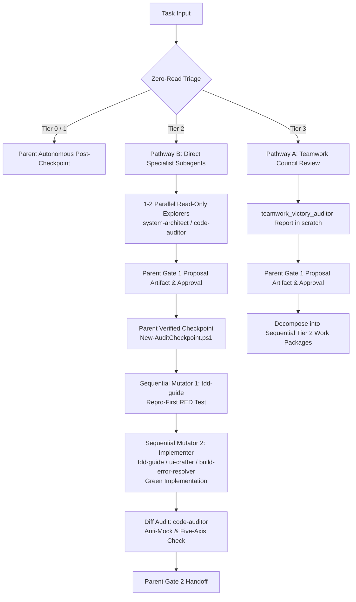

# Universal Lead Orchestrator Protocol (Operational Runbook)

A high-rigor governance runbook enforcing Anthropic Lead-Agent context insulation, `obra/superpowers` subagent-driven development, and Antigravity multi-agent fleet coordination. Governed by `config/GEMINI.md` (`~/.gemini/GEMINI.md`) and [`ADR-0019`](../../../docs/adr/0019-universal-lead-orchestrator-and-context-insulation.md).

> [!TIP]
> **Workflow Routing**: `audit-dev-workflow` is the operational runbook for all changes (Tier 0–3). For Tier 2/3 multi-file changes, Parent Agent activates `orchestrator` for context insulation and subagent fleet governance.

---

## 1. Core Operational Invariants

### 1.1 Parent Context Insulation Invariant (Strict Application Code Ban)
- **Rule**: On Tier 2 (`standard`) and Tier 3 (`large`) tasks, the **Parent Agent** (identified by possessing `invoke_subagent` and `read_file`) is strictly prohibited from invoking `read_file` or `view_file` on application source code (`src/**`, `core/**`, `web/**`, `lib/**`, business logic implementations).
- **Allowed Parent Reads**: High-level task coordination files (`task_state.md`, ADR summaries, `specs/<feature>/*.md`), intermediate subagent dossiers in scratch (`<appDataDir>\brain\<conversation-id>\scratch\<task>\` or `$HOME/.gemini/antigravity/scratch/<task>/`), git tracking receipts (`rtk git status --short`, `rtk git diff --stat`), CLI test output, and raw `git --no-pager diff HEAD` / `git --no-pager diff --stat` specifically for programmatic Gate 2 artifact injection.
- **Subagent Mandate**: All deep code reading, syntax analysis, code editing, and test authoring belong exclusively to subagents (identified by possessing `view_file`, `replace_file_content`, and `write_to_file`).

### 1.2 Zero-Read Triage Gate (Step 0 Blast Radius Sizing — SSOT)
Before opening any source file, the Parent Agent classifies task blast radius using **zero-read metadata commands only**:
1. `rtk git status --short`: modified and untracked file counts.
2. `rtk rg --files` or `rtk rg -l "<symbol>"`: list of candidate files without reading contents.
3. `rtk rg -c "<symbol>"`: caller counts per file.
4. User prompt, issue description, or `task_state.md`.

*Sizing Thresholds (Canonical Definition)*:
- **Tier 0 (`trivial`: $\le 2$ files, $\le 3$ exec / $\le 5$ doc lines, zero logic/state/schema mutation)**: Single-turn Parent fast-path post-checkpoint. Subagents and Gate 1 bypassed; pauses at `[TRIVIAL REVIEW]` before commit.
- **Tier 1 (`small`: 1 module bugfix/enhancement)**: Autonomous Parent TDD post-checkpoint (`New-AuditCheckpoint.ps1` $\rightarrow$ RED test $\rightarrow$ GREEN fix $\rightarrow$ 5-Axis check per [audit-dev-workflow Phase 4.2](../audit-dev-workflow/SKILL.md#phase-4-local-verification--review) $\rightarrow$ Gate 2 `gate2_handoff.md`). Subagents optional on-demand.
- **Tier 2 (`standard`: 2–5 files, internal boundaries)**: Lead Parent Orchestrator + Direct Specialist Subagents. Parent inline code reading strictly banned. Read-only exploration precedes Gate 1 approval and Phase 2 checkpoint.
- **Tier 3 (`large`: >5 files, architectural overhaul, schema rewrite)**: Lead Parent Orchestrator + Single `teamwork` Council Review dispatch.
- **Package Installations**: Any addition, removal, or upgrade of dependencies (regardless of file count) strictly requires Gate 1 human approval before modifying files.
- **Mid-Execution Scope Escalation**: If execution reveals a task exceeds its initial tier boundaries (e.g. Tier 1 expanding to >2 files or crossing module boundaries):
  1. Halt active mutations immediately.
  2. Retain existing `checkpoint-<task>` branch—do NOT delete, overwrite, or re-run checkpoint creation.
  3. Pause autonomous execution, author `gate1_proposal.md`, and obtain explicit human approval before resuming file modifications.

### 1.3 Single-Writer Mutual Exclusion Invariant
- **Rule**: Parallel subagent dispatch is restricted strictly to read-only discovery.
- **Enforcement**: Mutating subagents (possessing `replace_file_content` or `write_to_file` targeting workspace files) MUST execute strictly serialized. Exactly ONE mutating subagent may run at any time to prevent Windows file-lock collisions (`IOException`) and preserve rollback atomicity.

### 1.4 Global Monotonic Stop-Rule Counter ($\le 2$) & Rollback Guarantee
- **Rule**: The Parent Orchestrator tracks a centralized `global_attempt_counter` ($\le 2$).
- **Enforcement**: Any failed repair attempt by any subagent or Parent increments the counter. At 2, all automation halts, Parent executes `Restore-AuditCheckpoint.ps1 -Task "<task>"`, reports verbatim failure receipts, and pauses for human direction. Zero escape-hatch code reads are permitted.
- **Re-Entry Post-Rollback**: When human operator provides explicit redirection or an alternative approach following a 2-attempt rollback halt, `global_attempt_counter` resets to 0 for the newly approved strategy.
- **Abnormal Termination**: If a mutating subagent crashes, times out, or leaves a dirty tree, Parent immediately executes `Restore-AuditCheckpoint.ps1` before secondary actions.
- **Failed Reviewer Accounting (`Status: not run` vs 0 Findings)**: Any delegated reviewer or subagent that times out, encounters an unhandled tool exception, or fails to complete execution MUST be accounted as `Status: not run`. It is strictly prohibited to treat a failed or aborted reviewer run as "0 findings" or an implicit pass. Any required reviewer with `not run` status invalidates approval.

### 1.5 Anti-Mock Cheating & Repro-First RED Verification
- **Rule**: For bug fixes in Tier 2/3, after Gate 1 approval and verified `New-AuditCheckpoint.ps1`, Parent dispatches `tdd-guide` to author a failing test on unmodified production code (RED state) and witnesses the failing CLI test receipt (`run_command`) before delegating the fix.
- **Diff Audit**: Before presenting Gate 2, Parent delegates line-by-line diff review to `code-auditor` or `silent-failure-hunter` to audit for mock-cheating, weakened assertions, or test deletion against the [Five-Axis rubric](../audit-dev-workflow/SKILL.md#phase-4-local-verification--review).
- **Settled Findings Immunity**: Review findings that have been formally settled (contested with verified code coordinates or accepted as documented operator trade-offs) are immune to re-litigation by subsequent review passes or subagent dispatches. Parent must pass settled items under `Settled Findings:` in `<SCOPE_AND_BOUNDARIES>` to prevent endless review churn.

### 1.6 Subagent Commit/Push Ban, Shell Safety & Direct Parent CLI Test Runner
- **Subagent Commit & PR Ban**: Subagents are strictly barred from running `git commit`, `git tag`, `git push`, `gh pr create`, `gh pr merge`, or `gh release create`. Commit and PR authority belongs exclusively to the Parent Agent post-Gate 2 approval.
- **AST Shell Validation**: Any non-standard mutating or file-deleting shell command executed by Parent or Subagent must first pass `Test-PowerShellCommandSafety.ps1` per `config/GEMINI.md#L63`.
- **Direct Parent Test Runner**: Parent must directly run the verification test command via `run_command`, verifying exit code 0 AND positive assertion count ($>0$ passed, $0$ failed per ADR-0015). For testless repos, label `[TEST HARNESS: NONE]` and verify via static compilation/linter/build checks.

### 1.7 Pre-Mutation Syntax Interception (SWE-Agent Fast Syntax Gate — SSOT)
- **Fast Syntax Gate**: Before executing test runners or presenting verification, mutators or Parent run a rapid syntax check on modified files (`node --check <file>` or `rtk npx tsc --noEmit` for Node/JS/TS, `python -m py_compile <file>` for Python, `[System.Management.Automation.Language.Parser]::ParseFile("<file>", [ref]$null, [ref]$err)` for PowerShell).
- **In-Turn Fix**: Syntax typos, missing delimiters, or parse errors caught by this pre-mutation check are fixed immediately in-turn without incrementing `global_attempt_counter` ($\le 2$), which is reserved strictly for semantic, build, or test assertion failures.

---

## 2. Adaptive Dual Dispatch Protocol



### Pathway A: Deliberative Multi-Seat Council (Tier 3)
Dispatch exactly ONE call to `teamwork` with `Role: "Council Review Panel"` per `council-review/SKILL.md`. Direct specialist agent calls from Parent are prohibited for Tier 3 evaluations. Once Gate 1 approval is granted for the council proposal, execution decomposes into sequential Tier 2 work packages orchestrated by Parent via Pathway B.

### Pathway B: Focused Domain Specialists (Tier 1 On-Demand / Tier 2 Execution)
Parent dispatches targeted custom subagents directly via `invoke_subagent`:
- Greenfield Spec & Planning: `system-architect` applying [`spec-kit`](../spec-kit/SKILL.md) (`/speckit.specify` $\rightarrow$ `/speckit.plan` $\rightarrow$ `/speckit.tasks`) and [`contract-first`](../contract-first/SKILL.md).
- Discovery: `system-architect` (contracts/topology), `code-auditor` (hygiene/security), `database-reviewer` (schema/index review).
- Test Authoring (Post-Gate 1 & Post-Checkpoint): `tdd-guide` (Red-Green-Refactor, boundary assertions).
- Fix / Feature Implementation: `tdd-guide` (logic/feature code), `ui-crafter` (frontend UI/accessibility), `build-error-resolver` (type/compiler errors via `replace_file_content`), `docs-architect` (ADRs/docs/`task_state.md`), `l10n-humanizer` (localization resources), `maintenance-bot` (CI/Dependabot).
- Quality Gate: `code-auditor` or `silent-failure-hunter` (diff review), `spec-verifier` (Context7 & [`deep-web-research`](../deep-web-research/SKILL.md) API checks).

> [!NOTE]
> **Dynamic Model Elevation (ADR-0015)**: When Parent Orchestrator runs on `flash` for cost/speed efficiency, specialized verification dispatches involving high-stakes schema migrations (`database-reviewer`) or deep third-party API contract verification (`spec-verifier`) may dynamically elevate subagent invocation to `Model: pro` or `Model: inherit` per `subagent-patterns.md` to prevent subtle logical drift.

---

## 3. The 4-Slot Delegation Contract (SSOT)

Every `invoke_subagent` prompt issued by the Parent Orchestrator MUST adhere to this 4-slot structure:

```markdown
ROLE_TYPE: SUBAGENT (EXECUTION SPECIALIST)

<ROLE_AND_OBJECTIVE>
You are <Agent Role>. Your objective is <concrete objective>.
Zero Process Leaks: do not emit AI process tags or commit markers.
</ROLE_AND_OBJECTIVE>

<SCOPE_AND_BOUNDARIES>
Target Coordinates: <file.ext#Lxx-Lyy>
Allowed Mutation Paths: <explicit file list, directory, or NONE (Read-Only)>
Settled Findings: <list of established baseline non-issues / accepted trade-offs immune to re-litigation, or NONE>
Deny Paths: ~/.ssh/**, ~/.aws/**, ~/.gnupg/**, **/.env*, **/*.key, **/*.pem, mcp/**
</SCOPE_AND_BOUNDARIES>

<TOOLS_AND_ABSOLUTE_SKILL_PATHS>
Tools: Use view_file to inspect code; use replace_file_content (or write_to_file if granted in agent manifest) for edits.
Bound Skills (resolve exact OS absolute paths from <skills> header; never pass ~ or $HOME to view_file):
- <Absolute OS path to skill 1, e.g. C:\Users\<User>\.gemini\config\skills\<skill>\SKILL.md>
</TOOLS_AND_ABSOLUTE_SKILL_PATHS>

<RETURN_CONTRACT>
Write detailed forensic reports to <appDataDir>\brain\<conversation-id>\scratch\<task>\<file>.md (unless using build-error-resolver without write_to_file).
In your final chat message, return ONLY this compact receipt (<= 15 lines):
- Status: [PASS | FAIL | BLOCKED | NOT RUN]
- Target Coordinates: <file.ext#Lxx-Lyy>
- Caller Blast Radius: <N callers across M files>
- CLI Test Command: <command executed or N/A>
- Exit Code: <0 or non-zero>
- Assertions: <N passed, 0 failed>
- Deliverable Path: <scratch path or N/A (in-place edit only)>
</RETURN_CONTRACT>
```

---

## 4. Parent Anti-Rationalization Table

| Rationalization / Excuse | Reality & Binding Invariant | Correct Action |
| :--- | :--- | :--- |
| *"I'll just read one target file to understand the bug."* | Reading 1 file invariably escalates to reading 5 files, burning 30k tokens and degrading reasoning. | Use `rtk rg -l` and `rtk rg -c` for Zero-Read Triage. Dispatch `system-architect` or `code-auditor`. |
| *"Direct reading is faster than spawning a subagent."* | Inline reading pollutes Parent context, triggering middle-loss, dropped safety checks, and hallucinated test passes. | Subagent dispatch takes 1 turn and guarantees context insulation. |
| *"The task is small enough that I don't need a subagent."* | If it crosses module boundaries (>1 module or >2 non-test files) or requires architectural redesign, it is Tier 2 by definition (ADR-0009, ADR-0015, ADR-0019). | Follow the Zero-Read Triage Gate strictly; do not rationalize away Tier 2 boundaries. |
| *"The subagent reported green, so I can commit directly."* | Subagents may mock-cheat, delete tests, or suffer from Exit Code 0 fallacies. | Parent independently runs CLI tests (`run_command`) and validates $>0$ passed assertions. |
| *"Two subagents failed, let me read the code to fix it myself."* | Violates the 2-Attempt Stop Rule and ADR-0019 clean-fail invariant. | Execute `$HOME\.gemini\config\skills\audit-dev-workflow\scripts\Restore-AuditCheckpoint.ps1`, record failure evidence, and escalate to human operator. |
