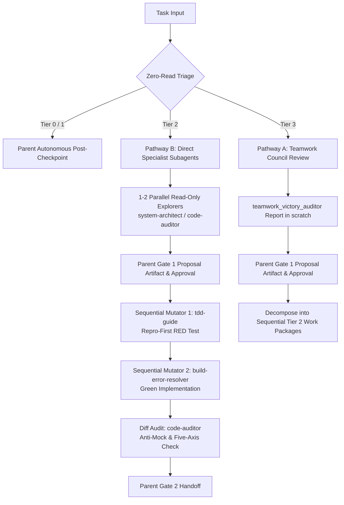

# Universal Lead Orchestrator Protocol (Operational Runbook)

A high-rigor governance runbook enforcing Anthropic Lead-Agent context insulation, `obra/superpowers` subagent-driven development, and Antigravity multi-agent fleet coordination. Governed by `config/GEMINI.md` (`~/.gemini/GEMINI.md`) and [`ADR-0019`](../../../docs/adr/0019-universal-lead-orchestrator-and-context-insulation.md).

---

## 1. Core Operational Invariants

### 1.1 Parent Context Insulation Invariant (Strict Application Code Ban)
- **Rule**: On Tier 2 (`standard`) and Tier 3 (`large`) tasks, the **Parent Agent** (identified by possessing `invoke_subagent` and `read_file`) is strictly prohibited from invoking `read_file` or `view_file` on application source code (`src/**`, `core/**`, `web/**`, `lib/**`, business logic implementations).
- **Allowed Parent Reads**: High-level task coordination files (`task_state.md`, ADR summaries), intermediate subagent dossiers in scratch (`~/.gemini/antigravity/scratch/` or `<appDataDir>\brain\<conversation-id>\scratch\`), git tracking receipts (`rtk git status --short`, `rtk git diff --stat`), and CLI test output.
- **Subagent Mandate**: All deep code reading, syntax analysis, code editing, and test authoring belong exclusively to subagents (identified by possessing `view_file`, `replace_file_content`, and `write_to_file`).

### 1.2 Zero-Read Triage Gate (Step 0 Blast Radius Sizing)
Before opening any source file, the Parent Agent classifies task blast radius using **zero-read metadata commands only**:
1. `rtk git status --short`: modified and untracked file counts.
2. `rtk rg --files` or `rtk rg -l "<symbol>"`: list of candidate files without reading contents.
3. `rtk rg -c "<symbol>"`: caller counts per file.
4. User prompt, issue description, or `task_state.md`.

*Sizing Thresholds*:
- **Tier 0 (`trivial`: $\le 2$ files, $\le 3$ exec / $\le 5$ doc lines)**: Single-turn Parent fast-path post-checkpoint. Subagents bypassed.
- **Tier 1 (`small`: 1 module bugfix/enhancement)**: Autonomous Parent TDD post-checkpoint. Subagents optional on-demand.
- **Tier 2 (`standard`: 2–5 files, internal boundaries)**: Lead Parent Orchestrator + Direct Specialist Subagents. Parent inline reading strictly banned.
- **Tier 3 (`large`: >5 files, architectural overhaul, schema rewrite)**: Lead Parent Orchestrator + Single `teamwork` Council Review dispatch.
- **Package Installations**: Any addition, removal, or upgrade of dependencies (regardless of file count) strictly requires Gate 1 human approval before modifying files.

### 1.3 Single-Writer Mutual Exclusion Invariant
- **Rule**: Parallel subagent dispatch is restricted strictly to read-only discovery.
- **Enforcement**: Mutating subagents (possessing `replace_file_content` or `write_to_file` targeting workspace files) MUST execute strictly serialized. Exactly ONE mutating subagent may run at any time to prevent Windows file-lock collisions (`IOException`) and preserve rollback atomicity.

### 1.4 Global Monotonic Stop-Rule Counter ($\le 2$) & Rollback Guarantee
- **Rule**: The Parent Orchestrator tracks a centralized `global_attempt_counter` ($\le 2$).
- **Enforcement**: Any failed repair attempt by any subagent or Parent increments the counter. At 2, all automation halts, Parent executes `Restore-AuditCheckpoint.ps1 -Task "<task>"`, reports verbatim failure receipts, and pauses for human direction. Zero escape-hatch code reads are permitted.
- **Abnormal Termination**: If a mutating subagent crashes, times out, or leaves a dirty tree, Parent immediately executes `Restore-AuditCheckpoint.ps1` before secondary actions.

### 1.5 Anti-Mock Cheating & Repro-First RED Verification
- **Rule**: For bug fixes in Tier 2/3, Parent must witness a failing test receipt (`run_command`) on unmodified code (RED state) authored by `tdd-guide` before delegating the fix.
- **Diff Audit**: Before presenting Gate 2, Parent delegates line-by-line diff review to `code-auditor` or `silent-failure-hunter` to audit for mock-cheating, weakened assertions, or test deletion.

### 1.6 Subagent Commit Ban & Direct Parent CLI Test Runner Execution
- **Subagent Commit Ban**: Subagents are strictly barred from running `git commit`, `git tag`, or `git push`. Commit authority belongs exclusively to the Parent Agent post-Gate 2 approval.
- **Direct Parent Test Runner**: Parent must directly run the verification test command via `run_command`, verifying exit code 0 AND positive assertion count ($>0$ passed, $0$ failed per ADR-0015). For testless repos, label `[TEST HARNESS: NONE]` and verify via static compilation/linter/build checks.

### 1.7 Pre-Mutation Syntax Interception (SWE-Agent Fast Syntax Gate)
- **Fast Syntax Gate**: Before executing test runners or presenting verification, mutators or Parent run a rapid syntax check on modified files (`node --check <file>` for Node/JS, `python -m py_compile <file>` for Python, `[System.Management.Automation.Language.Parser]::ParseFile("<file>", [ref]$null, [ref]$err)` for PowerShell).
- **In-Turn Fix**: Syntax typos, missing delimiters, or parse errors caught by this pre-mutation check are fixed immediately in-turn without incrementing `global_attempt_counter` ($\le 2$), which is reserved strictly for semantic, build, or test assertion failures.

---

## 2. Adaptive Dual Dispatch Protocol



### Pathway A: Deliberative Multi-Seat Council (Tier 3)
Dispatch exactly ONE call to `teamwork` with `Role: "Council Review Panel"` per `council-review/SKILL.md`. Direct specialist agent calls from Parent are prohibited for Tier 3 evaluations. Once Gate 1 approval is granted for the council proposal, execution decomposes into sequential Tier 2 work packages orchestrated by Parent via Pathway B.

### Pathway B: Focused Domain Specialists (Tier 1 On-Demand / Tier 2 Execution)
Parent dispatches targeted custom subagents directly via `invoke_subagent`:
- Discovery: `system-architect` (contracts/topology), `code-auditor` (hygiene/security).
- Test Authoring: `tdd-guide` (Red-Green-Refactor, boundary assertions).
- Fix Implementation: `build-error-resolver` (type errors), `tdd-guide` (logic fixes).
- Quality Gate: `code-auditor` (diff review), `spec-verifier` (Context7 API checks).

---

## 3. The 4-Slot Delegation Contract

Every `invoke_subagent` prompt issued by the Parent Orchestrator MUST adhere to this 4-slot structure:

```markdown
ROLE_TYPE: SUBAGENT (EXECUTION SPECIALIST)

<ROLE_AND_OBJECTIVE>
You are <Agent Role>. Your objective is <concrete objective>.
Zero Process Leaks: do not emit AI process tags or commit markers.
</ROLE_AND_OBJECTIVE>

<SCOPE_AND_BOUNDARIES>
Target Coordinates: <file.ext#Lxx-Lyy>
Allowed Mutation Paths: <explicit file list or directory>
Deny Paths: ~/.ssh/**, ~/.aws/**, ~/.gnupg/**, **/.env*, **/*.key, **/*.pem, mcp/**
</SCOPE_AND_BOUNDARIES>

<TOOLS_AND_ABSOLUTE_SKILL_PATHS>
Tools: Use view_file to inspect code; use replace_file_content or write_to_file for edits.
Bound Skills (resolve via absolute paths from prompt header):
- <Absolute path to skill 1>
- <Absolute path to skill 2>
</TOOLS_AND_ABSOLUTE_SKILL_PATHS>

<RETURN_CONTRACT>
Write detailed forensic reports to <appDataDir>\brain\<conversation-id>\scratch\<task>\<file>.md.
In your final chat message, return ONLY this compact receipt (<= 15 lines):
- Status: [PASS | FAIL | BLOCKED]
- Target Coordinates: <file.ext#Lxx-Lyy>
- Caller Blast Radius: <N callers across M files>
- CLI Test Command: <command executed>
- Exit Code: <0 or non-zero>
- Assertions: <N passed, 0 failed>
- Deliverable Path: <scratch path if applicable>
</RETURN_CONTRACT>
```

---

## 4. Parent Anti-Rationalization Table

| Rationalization / Excuse | Reality & Binding Invariant | Correct Action |
| :--- | :--- | :--- |
| *"I'll just read one target file to understand the bug."* | Reading 1 file invariably escalates to reading 5 files, burning 30k tokens and degrading reasoning. | Use `rtk rg -l` and `rtk rg -c` for Zero-Read Triage. Dispatch `system-architect` or `code-auditor`. |
| *"Direct reading is faster than spawning a subagent."* | Inline reading pollutes Parent context, triggering middle-loss, dropped safety checks, and hallucinated test passes. | Subagent dispatch takes 1 turn and guarantees context insulation. |
| *"The task is small enough that I don't need a subagent."* | If it touches $>2$ files or logic/state, it is Tier 2 by definition (ADR-0009, ADR-0015). | Follow the Zero-Read Triage Gate strictly; do not rationalize away Tier 2 boundaries. |
| *"The subagent reported green, so I can commit directly."* | Subagents may mock-cheat, delete tests, or suffer from Exit Code 0 fallacies. | Parent independently runs CLI tests (`run_command`) and validates $>0$ passed assertions. |
| *"Two subagents failed, let me read the code to fix it myself."* | Violates the 2-Attempt Stop Rule and ADR-0019 clean-fail invariant. | Execute `$HOME\.gemini\config\skills\audit-dev-workflow\scripts\Restore-AuditCheckpoint.ps1`, record failure evidence, and escalate to human operator. |
