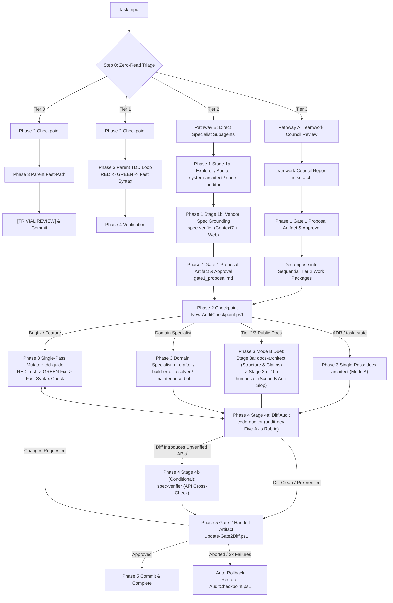

# Universal Lead Orchestrator Protocol (Operational Runbook)

A high-rigor governance runbook enforcing Anthropic Lead-Agent context insulation, `obra/superpowers` subagent-driven development, and Antigravity multi-agent fleet coordination. Governed by `config/GEMINI.md` (`~/.gemini/GEMINI.md`), [`ADR-0019`](../../../docs/adr/0019-universal-lead-orchestrator-and-context-insulation.md), and [`ADR-0028`](../../../docs/adr/0028-orchestrator-consolidation-audit-dev-streamlining-and-dual-subagent-pipeline.md).

> [!TIP]
> **Workflow Routing**: `orchestrator` is the sole authoritative operational runbook governing the end-to-end execution lifecycle across all tiers (Tier 0–3). For code quality auditing, skeptical verification, and the Five-Axis Review Rubric, consult [`audit-dev`](../audit-dev/SKILL.md).

---

## 1. Core Operational Invariants

### 1.1 Role-Scoped Execution & Context Insulation Invariant
- **Parent Lead Orchestrator (`invoke_subagent` present)**: On Tier 2 (`standard`) and Tier 3 (`large`) tasks, the Parent Agent is strictly prohibited from invoking `read_file` or `view_file` on application source code (`src/**`, `core/**`, `web/**`, `lib/**`, business logic implementations) AND strictly barred from calling `replace_file_content`, `multi_replace_file_content`, `write_to_file`, `edit_file`, or `write_file` on any workspace repository file. Parent write tools on Tier 2/3 are restricted strictly to session artifacts under `<appDataDir>\brain\<conversation-id>\*.md` and scratch files.
- **Allowed Parent Reads**: High-level task coordination files (`task_state.md`, ADR summaries, `specs/<feature>/*.md`), intermediate subagent dossiers in scratch (`<appDataDir>\brain\<conversation-id>\scratch\<task>\` or `$HOME/.gemini/antigravity/scratch/<task>/`), git tracking receipts (`rtk git status --short`, `rtk git diff --stat`), CLI test output, and raw `git --no-pager diff HEAD` / `git --no-pager diff --stat` specifically for programmatic Gate 2 artifact injection.
- **Execution Specialist Subagents (`invoke_subagent` absent)**: Deep code reading, syntax analysis, code editing, and test authoring belong exclusively to subagents. Mutating specialists (`tdd-guide`, `ui-crafter`, `docs-architect`, `l10n-humanizer`, `maintenance-bot`, `build-error-resolver`) are explicitly authorized to edit granted `<SCOPE>` paths within the active repository or sibling `<Project>-AI-Context` repo. Read-only specialists (`code-auditor`, `silent-failure-hunter`, `spec-verifier`, `system-architect`) write exclusively to `scratch/` dossiers.

### 1.2 Zero-Read Triage Gate (Step 0 Blast Radius Sizing — SSOT)
Before opening any source file, the Parent Agent classifies task blast radius using **zero-read metadata commands only**:
1. `rtk git status --short`: modified and untracked file counts.
2. `rtk rg --files` or `rtk rg -l "<symbol>"`: list of candidate files without reading contents.
3. `rtk rg -c "<symbol>"`: caller counts per file.
4. User prompt, issue description, or `task_state.md`.

*Sizing Thresholds (Canonical Definition)*:
- **Tier 0 (`trivial`: $\le 2$ files, $\le 3$ exec / $\le 5$ doc lines, zero logic/state/schema mutation)**: Single-turn Parent fast-path post-checkpoint. Subagents and Gate 1 bypassed; pauses at `[TRIVIAL REVIEW]` before commit.
- **Tier 1 (`small`: 1 module bugfix/enhancement)**: Autonomous Parent TDD post-checkpoint (`New-AuditCheckpoint.ps1` $\rightarrow$ RED test $\rightarrow$ GREEN fix $\rightarrow$ 5-Axis check per [`audit-dev/SKILL.md`](../audit-dev/SKILL.md) $\rightarrow$ Gate 2 `gate2_handoff.md`). Subagents optional on-demand.
- **Tier 2 (`standard`: 2–5 files, internal boundaries)**: Lead Parent Orchestrator + Direct Specialist Subagents. Parent inline code reading strictly banned. Read-only exploration precedes Gate 1 approval and Phase 2 checkpoint.
- **Tier 3 (`large`: >5 files, architectural overhaul, schema rewrite)**: Lead Parent Orchestrator + Single `teamwork` Council Review dispatch.
- **Package Installations**: Any addition, removal, or upgrade of dependencies (regardless of file count) strictly requires Gate 1 human approval before modifying files.
- **Mid-Execution Scope Escalation**: If execution reveals a task exceeds its initial tier boundaries (e.g. Tier 1 expanding to >2 files or crossing module boundaries):
  1. Halt active mutations immediately.
  2. Retain existing `checkpoint-<task>` branch—do NOT delete, overwrite, or re-run checkpoint creation.
  3. Pause autonomous execution, author `gate1_proposal.md`, and obtain explicit human approval before resuming file modifications.

### 1.3 Single-Writer Mutual Exclusion Invariant
- **Rule**: Parallel subagent dispatch is restricted strictly to read-only discovery.
- **Enforcement**: Mutating subagents (possessing `replace_file_content` or `write_to_file` targeting workspace files) MUST execute strictly serialized. Exactly ONE mutating subagent may run at any time to prevent Windows file-lock collisions (`IOException`) and preserve rollback atomicity.

### 1.4 Global Monotonic Stop-Rule Counter ($\le 2$) & Rollback Guarantee
- **Rule**: The Parent Orchestrator tracks a centralized `global_attempt_counter` ($\le 2$).
- **Enforcement**: Any failed repair attempt by any subagent or Parent increments the counter. At 2, all automation halts, Parent executes `Restore-AuditCheckpoint.ps1 -Task "<task>"`, reports verbatim failure receipts, and pauses for human direction. Zero escape-hatch code reads are permitted.
- **Re-Entry Post-Rollback**: When human operator provides explicit redirection or an alternative approach following a 2-attempt rollback halt, `global_attempt_counter` resets to 0 for the newly approved strategy.
- **Abnormal Termination**: If a mutating subagent crashes, times out, or leaves a dirty tree, Parent immediately executes `Restore-AuditCheckpoint.ps1` before secondary actions.
- **Failed Reviewer Accounting (`Status: not run` vs 0 Findings)**: Any delegated reviewer or subagent that times out, encounters an unhandled tool exception, or fails to complete execution MUST be accounted as `Status: not run`. It is strictly prohibited to treat a failed or aborted reviewer run as "0 findings" or an implicit pass. Any required reviewer with `not run` status invalidates approval.

### 1.5 Anti-Mock Cheating & Single-Pass TDD Verification
- **Single-Pass TDD Protocol**: When `tdd-guide` is the implementer for bug fixes and features in Tier 2/3, Parent dispatches `tdd-guide` once post-checkpoint. In a single continuous execution pass, `tdd-guide`: (1) authors the minimal failing test (RED) on unmodified production code, (2) runs the test runner to witness the expected failure, (3) writes the minimal production fix (GREEN), (4) runs the Pre-Mutation Syntax Interception Gate, (5) verifies the test suite passes (`exit code 0`, `> 0 passed, 0 failed`), (6) refactors under `ponytail`/`antislop-code`, and (7) returns a unified receipt with dual RED and GREEN verification traces. This eliminates the 40k–60k token double cold-start penalty between separate test-authoring and fix-implementation turns.
- **Cross-Specialist Split Handoff**: The separate two-stage dispatch (S2 test authoring -> S3 implementation) is reserved exclusively for cross-specialist tasks (e.g. `tdd-guide` writes contract tests, `ui-crafter` implements the frontend component).
- **Diff Audit**: Before presenting Gate 2, Parent delegates line-by-line diff review to `code-auditor` or `silent-failure-hunter` to audit for mock-cheating, weakened assertions, or test deletion against the [Five-Axis rubric in `audit-dev`](../audit-dev/SKILL.md).
- **Settled Findings Immunity**: Review findings that have been formally settled (contested with verified code coordinates or accepted as documented operator trade-offs) are immune to re-litigation by subsequent review passes or subagent dispatches. Parent must pass settled items under `Settled Findings:` in `<SCOPE>` strictly restricted to previously contested-with-evidence or operator-accepted items (never unreviewed assumptions) to prevent endless review churn.

### 1.6 Subagent Commit/Push Ban, Shell Safety & Direct Parent CLI Test Runner
- **Subagent Commit & PR Ban**: Subagents are strictly barred from running `git commit`, `git tag`, `git push`, `gh pr create`, `gh pr merge`, or `gh release create`. Commit and PR authority belongs exclusively to the Parent Agent post-Gate 2 approval.
- **AST Shell Validation**: Any non-standard mutating or file-deleting shell command executed by Parent or Subagent must first pass `Test-PowerShellCommandSafety.ps1` per `config/GEMINI.md#L64`.
- **Direct Parent Test Runner**: Parent must directly run the verification test command via `run_command`, verifying exit code 0 AND positive assertion count ($>0$ passed, $0$ failed per ADR-0015). For testless repos, label `[TEST HARNESS: NONE]` and verify via static compilation/linter/build checks.

### 1.7 Pre-Mutation Syntax Interception (SWE-Agent Fast Syntax Gate — SSOT)
- **Fast Syntax Gate**: Before executing test runners or presenting verification, mutators or Parent run a rapid syntax check on modified files (`node --check <file>` or `rtk npx tsc --noEmit` for Node/JS/TS, `python -m py_compile <file>` for Python, `[System.Management.Automation.Language.Parser]::ParseFile("<file>", [ref]$null, [ref]$err)` for PowerShell).
- **In-Turn Fix**: Syntax typos, missing delimiters, or parse errors caught by this pre-mutation check are fixed immediately in-turn without incrementing `global_attempt_counter` ($\le 2$), which is reserved strictly for semantic, build, or test assertion failures.

---

## 2. Adaptive Dual Dispatch Protocol & Lifecycle Flowchart



### Pathway A: Deliberative Multi-Seat Council (Tier 3)
Dispatch exactly ONE call to `teamwork` with `Role: "Council Review Panel"` per `council-review/SKILL.md`. Direct specialist agent calls from Parent are prohibited for Tier 3 evaluations. Once Gate 1 approval is granted for the council proposal, execution decomposes into sequential Tier 2 work packages orchestrated by Parent via Pathway B.

### Pathway B: Focused Domain Specialists (Tier 1 On-Demand / Tier 2 Execution)
Parent dispatches targeted custom subagents directly via `invoke_subagent`:
- Greenfield Spec & Planning: `system-architect` applying [`spec-kit`](../spec-kit/SKILL.md) (`/speckit.specify` $\rightarrow$ `/speckit.plan` $\rightarrow$ `/speckit.tasks`) and [`contract-first`](../contract-first/SKILL.md).
- Discovery: `system-architect` (contracts/topology), `code-auditor` (hygiene/security/database schema & migrations).
- Vendor Specification Grounding: `spec-verifier` (Context7 MCP & [`deep-web-research`](../deep-web-research/SKILL.md) API checks).
- Test & Feature Implementation (Post-Gate 1 & Post-Checkpoint): `tdd-guide` (Single-Pass Red-Green-Refactor, boundary assertions).
- Focused Mutators: `ui-crafter` (frontend UI/accessibility), `build-error-resolver` (type/compiler errors via `replace_file_content`), `docs-architect` (ADRs/docs/`task_state.md`), `l10n-humanizer` (localization resources & bilingual prose), `maintenance-bot` (CI/Dependabot).
- Quality Gate: `code-auditor` or `silent-failure-hunter` (diff review against [`audit-dev`](../audit-dev/SKILL.md)).

> [!NOTE]
> **Dynamic Model Elevation & Workspace Mode (ADR-0015 / ADR-0029)**: Across the 10-agent fleet, `build-error-resolver` and `maintenance-bot` default to `model: flash` while the other 8 specialists default to `model: inherit`. When Parent Orchestrator runs on `flash`, `Model: "inherit"` remains on `flash`; pass `Model: "pro"` dynamically in `invoke_subagent` to elevate `spec-verifier`, `system-architect`, or `docs-architect` for third-party API verification or high-stakes architectural synthesis. Default to `Workspace: inherit` to avoid Windows file locks and `node_modules` duplication, writing intermediate reports to `<appDataDir>\brain\<conversation-id>\scratch\<task>\`.

---

## 3. End-to-End Execution Lifecycle (Step 0 through Phase 5)

### Step 0: Zero-Read Triage Gate
Classify blast radius using zero-read CLI commands (`rtk git status --short`, `rtk rg -l`, `rtk rg -c`). Establish task tier per Section 1.2.

### Phase 1: Investigation, Audit & Pre-Gate 1 Planning
1. **Read-Only Exploration**: Parent dispatches read-only specialist subagents (`system-architect` or `code-auditor`) using the Lean 3-Slot delegation brief (`<OBJECTIVE>`, `<SCOPE>`, `<DELIVERABLE>`). Subagents inspect code coordinates and author diagnostic reports in `<appDataDir>\brain\<conversation-id>\scratch\<task>\`.
2. **Mandatory `code-auditor -> spec-verifier` Duet Pipeline (Pre-Gate 1 Planning)**:
   - Whenever `code-auditor` (or `system-architect`) completes a diagnostic audit or discovery pass in `scratch/` proposing fixes, library migrations, or configuration changes (**Stage 1a**), Parent MUST automatically dispatch **`spec-verifier` (Stage 1b)** before synthesizing `gate1_proposal.md` or presenting the audit report to the operator.
   - **`spec-verifier` Mandate**: Cross-checks all proposed API signatures, versions, options objects, and architectural patterns against official vendor documentation via Context7 MCP (`resolve-library-id` $\rightarrow$ `query-docs`) and version-locked web documentation (`deep-web-research`).
   - Any external API discrepancies, deprecated methods, or version mismatches are resolved in `scratch/` before drafting the proposal.
3. **Gate 1 Proposal Artifact (`gate1_proposal.md`)**:
   - For Tier 2/3 and package installations, Parent authors `<appDataDir>\brain\<conversation-id>/gate1_proposal.md` with `ArtifactMetadata` (`UserFacing: true`, `RequestFeedback: true`) per [`references/handoff-spec.md#22-gate-1-pre-execution-proposal-review`](references/handoff-spec.md#22-gate-1-pre-execution-proposal-review).
   - Parent outputs a 1–3 line chat message linking directly to the artifact and pauses for explicit human operator approval. (Tier 0 and Tier 1 skip Gate 1).

### Phase 2: Checkpoint Establishment
Upon receiving Gate 1 approval (or immediately following Step 0 for Tier 0/1):
1. Parent executes:
   ```powershell
   powershell -ExecutionPolicy Bypass -File "$HOME\.gemini\config\skills\orchestrator\scripts\New-AuditCheckpoint.ps1" -Task "<task>"
   ```
2. For git repositories, this creates a dedicated branch `checkpoint-<task>` pointing to HEAD. For non-git targets, it creates a verified backup in `$HOME/.gemini/antigravity/scratch/<task>/`.
3. If neither is possible, Parent halts and notifies the operator.

### Phase 3: Execution & Single-Pass TDD
1. **Code Features / Bug Fixes**: Parent dispatches `tdd-guide` under the Single-Pass TDD Protocol (Section 1.5). `tdd-guide` writes the RED test, executes the failure receipt, writes the GREEN fix, runs the Fast Syntax Gate, and verifies test success in a single continuous pass.
2. **Domain Specialists**: When specialized tasks are required, Parent dispatches the appropriate single mutator (`ui-crafter`, `build-error-resolver`, `maintenance-bot`) strictly serialized per the Single-Writer Invariant (Section 1.3).
3. **Conditional Mode B Duet for Public Repository Documentation**:
   - For Tier 2/3 public/narrative repository docs (`README.md`, `TOOLKIT.md`, `CONTRIBUTING.md`, `CHANGELOG.md`, and non-ADR `docs/**/*.md`), Parent executes a serialized two-stage duet:
     - **Stage 3a (`docs-architect` - Mode B)**: Formulates the 4-part pragmatic README/doc structure, grounds technical claims in verified code, verifies CLI snippets, and enforces clean documentation standards.
     - **Stage 3b (`l10n-humanizer` - Scope B)**: Reviews and humanizes the drafted prose, stripping AI writing tells, marketing hyperbole, and promotional slop while strictly preserving technical facts, code blocks, and CLI flags verbatim.
   - *Exemption*: Mode A documentation (`docs/adr/**`, `task_state.md`, architecture topology maps) and Tier 0/1 documentation edits remain single-pass on `docs-architect`.
4. **Fast Syntax Gate**: All mutating subagents run pre-mutation syntax checks before reporting completion.

### Phase 4: Local Verification & Quality Gate
1. **Direct Parent CLI Test Runner**: Parent independently executes the test command via `run_command` and validates `exit code 0` AND positive assertion count ($>0$ passed, $0$ failed).
2. **Stage 4a: Diff Audit (`code-auditor`)**:
   - Parent dispatches `code-auditor` to audit the unified diff (`rtk git diff --stat=140,80 HEAD`) against the [Five-Axis Skeptical Audit Rubric in `audit-dev`](../audit-dev/SKILL.md) and check for mock-cheating, weakened assertions, or test deletion.
3. **Stage 4b: Conditional Spec Verification (`spec-verifier`)**:
   - If Phase 3 introduced new third-party APIs or dependency options not already certified during Phase 1 Stage 1b, Parent dispatches `spec-verifier` to cross-check them against Context7 MCP before proceeding to Gate 2.
4. **Clean-Fail Rollback**: If tests fail or code auditor rejects the diff twice (`global_attempt_counter == 2`), Parent halts and executes:
   ```powershell
   powershell -ExecutionPolicy Bypass -File "$HOME\.gemini\config\skills\orchestrator\scripts\Restore-AuditCheckpoint.ps1" -Task "<task>"
   ```

### Phase 5: Gate 2 Programmatic Diff, Commit & Push
1. **Gate 2 Packaging (`gate2_handoff.md`)**:
   - Parent authors `<appDataDir>\brain\<conversation-id>/gate2_handoff.md` with placeholders `{{VERBATIM_GIT_DIFFSTAT}}` and `{{VERBATIM_GIT_DIFF}}`.
   - Parent executes:
     ```powershell
     powershell -ExecutionPolicy Bypass -File "$HOME\.gemini\config\skills\orchestrator\scripts\Update-Gate2Diff.ps1" -ArtifactPath "<appDataDir>\brain\<conversation-id>\gate2_handoff.md"
     ```
   - Parent outputs a 1–3 line chat message linking directly to `gate2_handoff.md` and pauses for human operator approval.
2. **Commit Discipline**:
   - Upon operator approval, Parent commits using Conventional Commits (`type(scope): description`) per `clean-docs`. Zero process leaks (no internal audit phase tags or AI markers in commit messages).
3. **Branch Cleanup & CI**:
   - Parent deletes the temporary checkpoint branch (`rtk git branch -d "checkpoint-<task>"`; never use force `-D`) and pushes upstream if applicable.

---

## 4. Lean 3-Slot Delegation Brief (SSOT)

Every `invoke_subagent` prompt issued by the Parent Orchestrator uses this Lean 3-Slot XML brief. Static agent identity, `<skills>` OS paths, `Deny Paths`, and full receipt recipes live natively in `agent.md`, `<skills>` injection, `GEMINI.md`, and Guard 2 (`Invoke-AntigravityHook.ps1`), eliminating per-dispatch boilerplate:

```markdown
<OBJECTIVE>
<Concrete task goal, verification bar, and conditional mode (e.g., Mode A vs Mode B) if applicable>
</OBJECTIVE>

<SCOPE>
Targets: <file.ext#Lxx-Lyy or target symbol/module>
Allowed Mutation Paths: <explicit file list, directory, or NONE (Read-Only)>
Settled Findings: <previously contested-with-evidence or operator-accepted items only (never unreviewed assumptions), or NONE>
</SCOPE>

<DELIVERABLE>
Scratch Report: <appDataDir>\brain\<conversation-id>\scratch\<task>\<file>.md (omit for build-error-resolver)
Return ONLY the compact <= 15-line summary defined in ## Output of your agent.md (built-in fallback: Status, Targets, Blast Radius, Verification Command/Exit Code/Assertions, Deliverable Path).
</DELIVERABLE>
```

---

## 5. Parent Anti-Rationalization Table

| Rationalization / Excuse | Reality & Binding Invariant | Correct Action |
| :--- | :--- | :--- |
| *"I'll just read one target file to understand the bug."* | Reading 1 file invariably escalates to reading 5 files, burning 30k tokens and degrading reasoning. | Use `rtk rg -l` and `rtk rg -c` for Zero-Read Triage. Dispatch `system-architect` or `code-auditor`. |
| *"Direct reading is faster than spawning a subagent."* | Inline reading pollutes Parent context, triggering middle-loss, dropped safety checks, and hallucinated test passes. | Subagent dispatch takes 1 turn and guarantees context insulation. |
| *"The task is small enough that I don't need a subagent."* | If it crosses module boundaries (>1 module or >2 non-test files) or requires architectural redesign, it is Tier 2 by definition (ADR-0009, ADR-0015, ADR-0019, ADR-0028). | Follow the Zero-Read Triage Gate strictly; do not rationalize away Tier 2 boundaries. |
| *"The subagent reported green, so I can commit directly."* | Subagents may mock-cheat, delete tests, or suffer from Exit Code 0 fallacies. | Parent independently runs CLI tests (`run_command`) and validates $>0$ passed assertions. |
| *"Two subagents failed, let me read the code to fix it myself."* | Violates the 2-Attempt Stop Rule and ADR-0019 clean-fail invariant. | Execute `$HOME\.gemini\config\skills\orchestrator\scripts\Restore-AuditCheckpoint.ps1`, record failure evidence, and escalate to human operator. |
